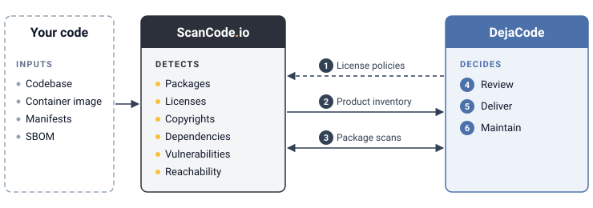

.. _reference_scancodeio_workflow:

ScanCode.io and DejaCode Compliance Workflow
============================================

**ScanCode.io detects what is in your code. DejaCode records what you decide about it.**

ScanCode.io analyzes one codebase at a time. DejaCode manages the compliance of all your
Products over time.

This page covers how the two work together. For everything else that DejaCode does, such
as the License Library, Workflow Requests, and Reporting, see the
:doc:`documentation home <index>`.

         inventory detected by ScanCode.io (2), and requests Package scans (3). DejaCode
         then supports the review (4), delivery (5), and maintenance (6) of the Product.

Each number in the diagram is a step of the workflow, described below.

1. Set Up
---------

- Enable the ScanCode.io, VulnerableCode, and PurlDB integrations, see
  :ref:`integrations_aboutcode`.
- Define your usage policies, see :ref:`how_to_1`.
- Share your license policies with ScanCode.io, which then flags each detected license
  with your compliance alerts, see :ref:`how_to_1_export_license_policies`.
- Activate your policy rules, see :ref:`reference_policy_rules`.
- Create a Product for each version of the software that you distribute, see
  :ref:`user_tutorial_1`.

2. Discover the Inventory
-------------------------

Choose the import action from the :guilabel:`Actions` dropdown of the Product, according
to what you have:

.. list-table::
   :header-rows: 1
   :widths: 30 35 35

   * - You have
     - Action
     - ScanCode.io pipeline
   * - An SBOM (CycloneDX, SPDX)
     - :guilabel:`Import SBOM`
     - ``load_sbom``, run by DejaCode
   * - Package manifests or lockfiles
     - :guilabel:`Import Package manifests`
     - ``resolve_dependencies``, run by DejaCode
   * - A ScanCode.io project
     - :guilabel:`Import ScanCode.io project`
     - Any pipeline, already run
   * - A ScanCode scan results file
     - :guilabel:`Import ScanCode scan results`
     - None: the file is imported as is

For an in-depth analysis, run the pipelines in ScanCode.io, then import the project: it
brings the Packages, their dependencies, and their vulnerabilities. With the
``find_vulnerabilities`` and ``analyze_symbols_reachability`` pipelines, it also brings
the reachability of each vulnerability.

Imports run in the background, follow them on the :guilabel:`Activity` tab of the
Product. A Package that already exists in your Dataspace keeps its curated data.

3. Enrich the Packages
----------------------

The discovery identifies the Packages and their declared licenses. A scan of each
Package goes further: it detects the licenses and copyrights in its files.

- :guilabel:`Scan all Packages` sends each Package of the Product with a download URL to
  ScanCode.io.
- On the :guilabel:`Scan` tab of a Package, apply the detected values to its definition,
  see :ref:`reference_license_clarity`.
- :guilabel:`Improve Packages from PurlDB` completes the Package metadata.

A Package is scanned and reviewed once, and every Product that uses it benefits.

4. Review
---------

- Set the review status and concluded license of each Package in the Product, see
  :ref:`user_tutorial_5_sboms`.
- Resolve the policy violations, see :ref:`reference_policy_rules`.
- Triage the vulnerabilities, see :ref:`how_to_4`. The reachability imported from
  ScanCode.io is a starting point.

5. Deliver
----------

Export from the reviewed Product. Unlike the ScanCode.io outputs, built from the scan
results, these documents reflect your review decisions.

- **SBOM** (CycloneDX, SPDX), see :ref:`user_tutorial_5_sboms`.
- **VEX**, see :ref:`user_tutorial_6_vuln_report`.
- **Attribution**, see :ref:`user_tutorial_1`.

6. Maintain
-----------

- **New release**: clone the Product, then import the new release. The clone keeps the
  inventory and its review. Imports only add Packages: remove the ones that are no
  longer in the release.
- **New vulnerabilities**: DejaCode refreshes them daily by default and can notify you,
  see :ref:`reference_vulnerability_management`.

Automate
--------

Each import action is available on the Product endpoint of the REST API:
``load_sboms``, ``import_manifests``, ``pull_scancodeio_project_data``, and
``import_from_scan``. See :ref:`integrations_rest_api`.

The ScanCode.io tutorial `Analyze Codebase End to End with DepLock and DejaCode
<https://scancodeio.readthedocs.io/en/latest/tutorial_cli_end_to_end_scanning_to_dejacode.html>`_
shows a complete example.
